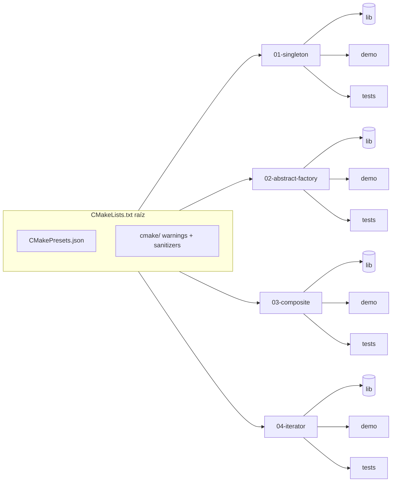
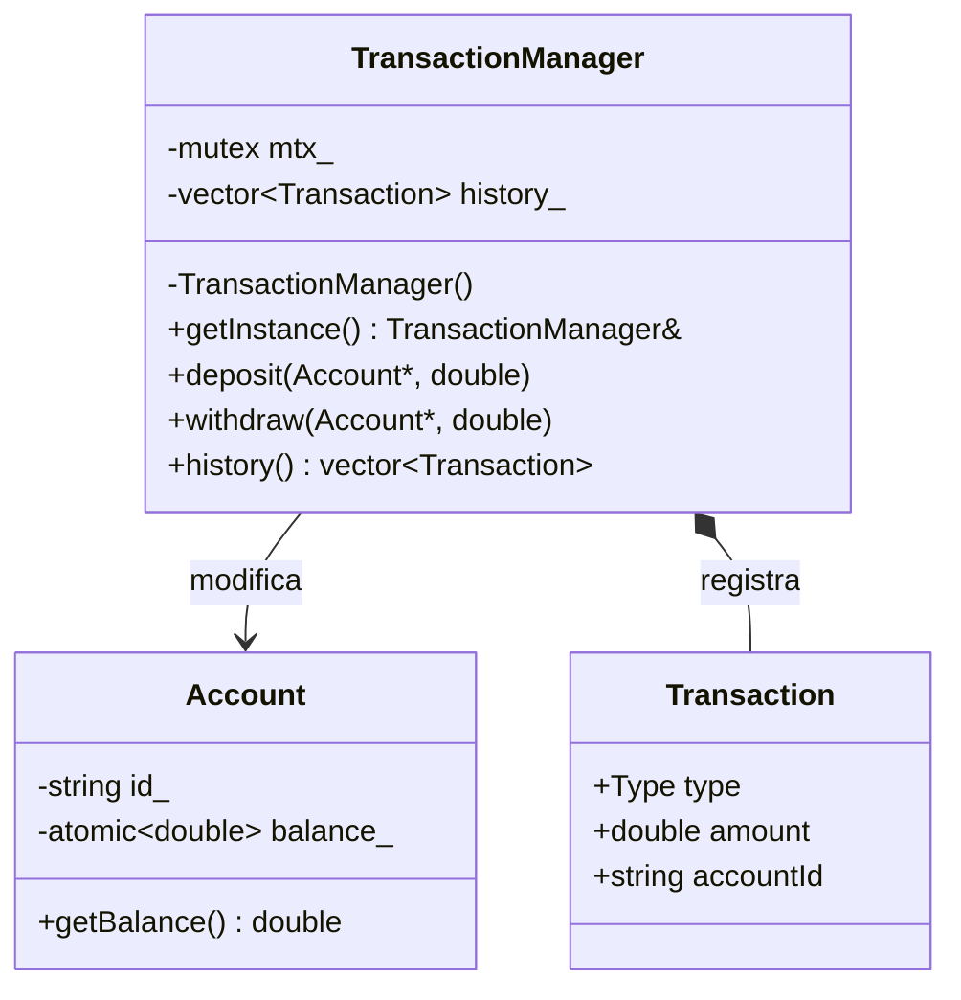
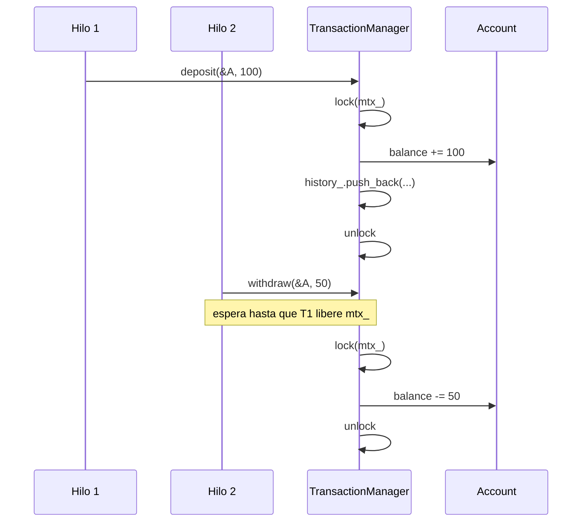
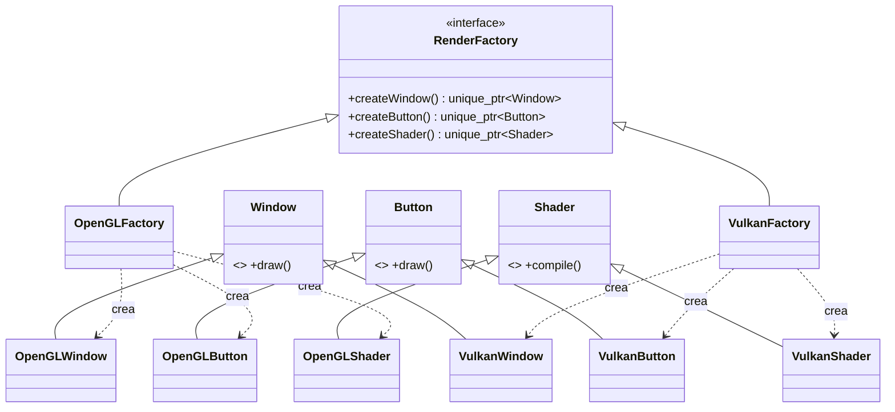
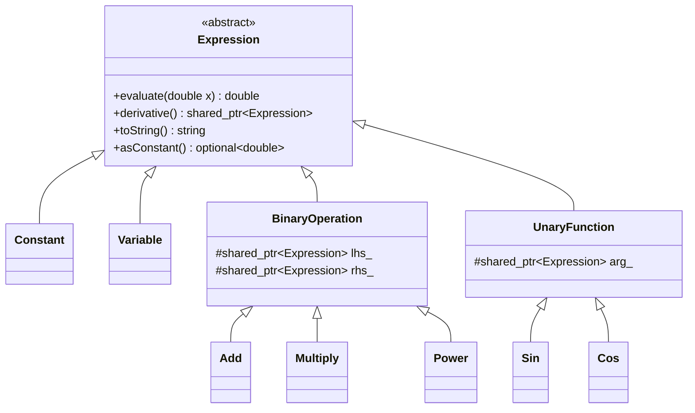
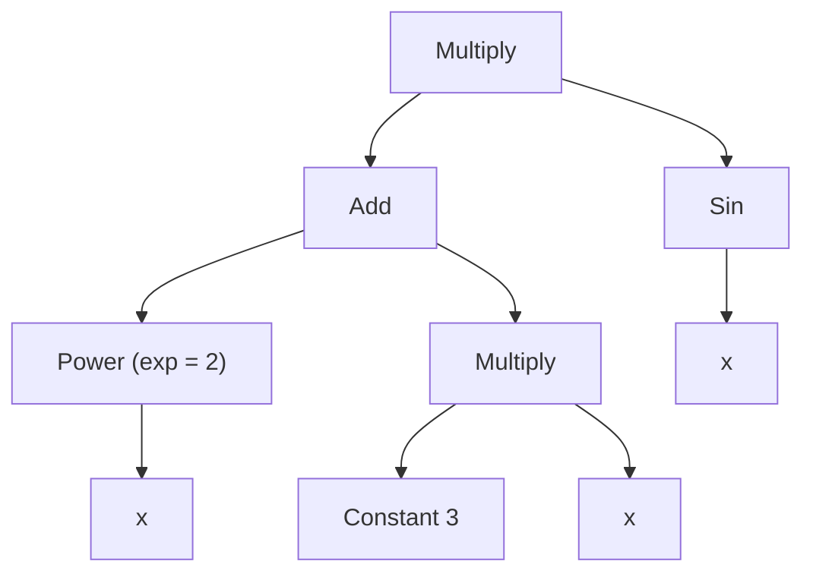
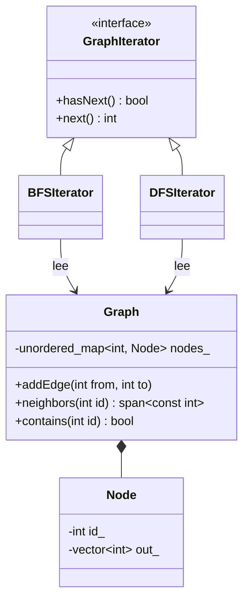

# cpp-design-patterns


Cuatro patrones de diseño implementados en **C++20 moderno**, cada uno aplicado a un problema concreto y documentado como una guía: qué problema resuelve, cómo está diseñada la solución, cómo se prueba y cómo se extiende.

| # | Patrón | Problema aplicado | Idea clave |
|---|---|---|---|
| 1 | **Singleton** | Gestor de transacciones bancarias concurrentes | Una única instancia global con operaciones atómicas |
| 2 | **Abstract Factory** | Motor de renderizado OpenGL / Vulkan | Cambiar de familia de objetos en ejecución sin `if` ni `switch` |
| 3 | **Composite** | Expresiones matemáticas simbólicas | Evaluar, imprimir y derivar un árbol sin `dynamic_cast` |
| 4 | **Iterator** | Recorrido de un grafo dirigido | BFS y DFS intercambiables sin exponer la estructura interna |

---

## Tabla de contenidos

1. [Objetivos y principios de diseño](#1-objetivos-y-principios-de-diseño)
2. [Arquitectura general](#2-arquitectura-general)
3. [Inicio rápido](#3-inicio-rápido)
4. [Módulo 1: Singleton, Transaction Manager](#4-módulo-1-singleton-transaction-manager)
5. [Módulo 2: Abstract Factory, motor de renderizado](#5-módulo-2-abstract-factory-motor-de-renderizado)
6. [Módulo 3: Composite, expresiones matemáticas](#6-módulo-3-composite-expresiones-matemáticas)
7. [Módulo 4: Iterator, recorrido de grafo](#7-módulo-4-iterator-recorrido-de-grafo)
8. [Estrategia de pruebas](#8-estrategia-de-pruebas)
9. [Replicabilidad: build, presets y CI](#9-replicabilidad-build-presets-y-ci)
10. [Mantenibilidad: convenciones y cómo extender](#10-mantenibilidad-convenciones-y-cómo-extender)
11. [Decisiones de arquitectura (ADR)](#11-decisiones-de-arquitectura-adr)
12. [Problemas frecuentes](#12-problemas-frecuentes)
13. [Licencia](#13-licencia)

---

## 1. Objetivos y principios de diseño

**Objetivos**

- Mostrar cada patrón resolviendo un problema realista, no un ejemplo de libro.
- Que cualquiera pueda **clonar, compilar y verificar** el proyecto con tres comandos.
- Que añadir un backend, una función matemática o un tipo de recorrido sea **una extensión, no una modificación**.

**Principios**

| Principio | Cómo se aplica |
|---|---|
| Open/Closed | Nuevas fábricas, nodos de expresión e iteradores se agregan sin tocar el código existente |
| Programar contra interfaces | El cliente solo conoce `RenderFactory`, `Expression` y `GraphIterator` |
| Propiedad explícita | `std::unique_ptr` para propiedad exclusiva, `std::shared_ptr` solo donde hay subárboles compartidos |
| Inmutabilidad donde sea posible | Los nodos de `Expression` son inmutables, lo que permite compartirlos con seguridad |
| Sin estado global oculto | La única instancia global es el Singleton del módulo 1, y es deliberada |

---

## 2. Arquitectura general

El repositorio es un **monorepo con módulos independientes**. Cada módulo es una librería estática con su demo y sus tests; ninguno depende de otro.



### Estructura de directorios

```
cpp-design-patterns/
├── CMakeLists.txt
├── CMakePresets.json
├── cmake/
│   ├── CompilerWarnings.cmake
│   └── Sanitizers.cmake
├── docs/
│   └── adr/                       # decisiones de arquitectura
├── 01-singleton-transaction-manager/
│   ├── include/txn/               # API pública (headers)
│   │   ├── account.hpp
│   │   ├── transaction.hpp
│   │   └── transaction_manager.hpp
│   ├── src/                       # implementación
│   ├── app/main.cpp               # demo ejecutable
│   ├── tests/
│   └── CMakeLists.txt
├── 02-abstract-factory-render/    # misma estructura, include/render/
├── 03-composite-expressions/      # misma estructura, include/expr/
├── 04-iterator-graph/             # misma estructura, include/graph/
├── .github/workflows/ci.yml
├── .clang-format
├── LICENSE
└── README.md
```

**Convención de módulo:** `include/` es la API pública, `src/` es privado, `app/` contiene la demo y `tests/` las pruebas. Quien consume la librería solo ve `include/`.

---

## 3. Inicio rápido

**Requisitos:** compilador con C++20 (GCC 11+, Clang 14+, MSVC 19.30+) y CMake 3.20+. GoogleTest se descarga solo con `FetchContent`.

```bash
git clone https://github.com/lazheart/cpp-design-patterns.git
cd cpp-design-patterns

cmake --preset dev          # configura
cmake --build --preset dev  # compila
ctest --preset dev          # corre todos los tests
```

Ejecutar las demos:

```bash
./build/dev/01-singleton-transaction-manager/singleton_demo
./build/dev/02-abstract-factory-render/render_demo
./build/dev/03-composite-expressions/expr_demo
./build/dev/04-iterator-graph/graph_demo
```

---

## 4. Módulo 1: Singleton, Transaction Manager

### 4.1 Problema

Varios módulos registran depósitos y retiros sobre cuentas al mismo tiempo. Si cada uno coordinara por su cuenta habría estados inconsistentes. Se necesita **un único punto de coordinación** y que cada operación sea **atómica**.

### 4.2 Requisitos

| Requisito | Dónde se cumple |
|---|---|
| `TransactionManager` como Singleton | `transaction_manager.hpp`: constructor privado, copia y movimiento eliminados |
| Clase `Transaction` | `transaction.hpp` |
| `deposit(Account*, double)` y `withdraw(Account*, double)` | `TransactionManager` |
| Operaciones atómicas, sin carreras | `std::mutex` + `std::lock_guard` en cada operación |
| Dirección única del manager | Test que compara `&getInstance()` entre hilos |

### 4.3 Arquitectura





### 4.4 Implementación de referencia

```cpp
// include/txn/transaction_manager.hpp
class TransactionManager {
public:
    static TransactionManager& getInstance() {
        static TransactionManager instance;   // inicialización thread-safe (C++11)
        return instance;
    }

    TransactionManager(const TransactionManager&) = delete;
    TransactionManager& operator=(const TransactionManager&) = delete;
    TransactionManager(TransactionManager&&) = delete;
    TransactionManager& operator=(TransactionManager&&) = delete;

    void deposit(Account* account, double amount);
    void withdraw(Account* account, double amount);

private:
    TransactionManager() = default;
    std::mutex mtx_;
    std::vector<Transaction> history_;
};
```

```cpp
// src/transaction_manager.cpp
void TransactionManager::deposit(Account* account, double amount) {
    std::lock_guard<std::mutex> lock(mtx_);
    account->applyDelta(+amount);                       // solo accesible por el manager
    history_.push_back({Transaction::Type::Deposit, amount, account->id()});
}
```

### 4.5 Uso

```cpp
auto& manager = TransactionManager::getInstance();
Account account("A1", 1000);

std::vector<std::thread> threads;
for (int i = 0; i < 10; ++i) {
    threads.emplace_back([&] {
        manager.deposit(&account, 100);
        manager.withdraw(&account, 50);
    });
}
for (auto& t : threads) t.join();

std::cout << "Balance final: " << account.getBalance() << '\n';
std::cout << "Direccion manager: " << &TransactionManager::getInstance() << '\n';
```

**Salida esperada**

```
Balance final: 1500
Direccion manager: 0x55d0c3a1b2c0      # misma dirección en cada llamada
```

El balance se deduce así: `1000 + 10·100 − 10·50 = 1500`.

### 4.6 Decisiones de diseño

- **Meyers Singleton** en lugar de `new` + doble verificación: es más corto, no se puede usar mal y su inicialización es thread-safe por estándar.
- **Un mutex global** serializa todas las cuentas. Es simple y correcto; el costo es menos paralelismo. Si el rendimiento importara, la alternativa es un mutex por cuenta y `std::scoped_lock` para operaciones entre dos cuentas (evita interbloqueos). Ver [ADR-002](docs/adr/002-mutex-global.md).
- **`Account` oculta `applyDelta`** y solo el manager puede invocarlo (`friend`), de modo que no se puede mutar el saldo saltándose la coordinación.
- **`balance_` es `std::atomic<double>`**: las lecturas concurrentes de `getBalance()` no generan carrera aunque ocurran mientras hay escrituras.

### 4.7 Extras sugeridos

- `withdraw` lanza `InsufficientFundsException` si no hay saldo, con test.
- `history()` devuelve una copia protegida por el mutex.
- Test de estrés con 100 hilos y 10 000 operaciones bajo ThreadSanitizer.

---

## 5. Módulo 2: Abstract Factory, motor de renderizado

### 5.1 Problema

Una aplicación debe dibujar con **OpenGL o Vulkan** y poder cambiar de uno a otro **sin modificar el código cliente**. Mezclar un `Window` de OpenGL con un `Shader` de Vulkan produciría objetos incompatibles; hace falta garantizar **familias coherentes**.

### 5.2 Requisitos

| Requisito | Dónde se cumple |
|---|---|
| Interfaz `RenderFactory` | `render_factory.hpp` |
| `OpenGLFactory` y `VulkanFactory` | `opengl_factory.hpp`, `vulkan_factory.hpp` |
| Productos `Window`, `Button`, `Shader` | Interfaces + una implementación por plataforma |
| El cliente solo conoce `RenderFactory` | El `main` no incluye headers de productos concretos |
| Sin `if` ni `switch` | La plataforma se decide por la fábrica concreta, no por una condición |
| Comportamiento distinto por plataforma | Cada producto imprime/ejecuta algo propio de su API |
| Cambio de fábrica en tiempo de ejecución | Reasignar el `unique_ptr<RenderFactory>` |

### 5.3 Arquitectura



### 5.4 Implementación de referencia

```cpp
class RenderFactory {
public:
    virtual ~RenderFactory() = default;
    virtual std::unique_ptr<Window> createWindow() const = 0;
    virtual std::unique_ptr<Button> createButton() const = 0;
    virtual std::unique_ptr<Shader> createShader() const = 0;
};

class OpenGLFactory final : public RenderFactory {
public:
    std::unique_ptr<Window> createWindow() const override { return std::make_unique<OpenGLWindow>(); }
    std::unique_ptr<Button> createButton() const override { return std::make_unique<OpenGLButton>(); }
    std::unique_ptr<Shader> createShader() const override { return std::make_unique<OpenGLShader>(); }
};
```

### 5.5 Uso y cambio en tiempo de ejecución

```cpp
std::unique_ptr<RenderFactory> factory = std::make_unique<OpenGLFactory>();
auto window = factory->createWindow();
auto button = factory->createButton();
window->draw();     // [OpenGL] Dibujando ventana con contexto GL
button->draw();     // [OpenGL] Dibujando boton con glDrawElements

factory = std::make_unique<VulkanFactory>();   // cambio de plataforma
auto shader = factory->createShader();
shader->compile();  // [Vulkan] Compilando shader a SPIR-V
```

Los objetos creados **antes** del cambio siguen siendo de OpenGL; solo los creados después son de Vulkan. Esa separación es intencional: la fábrica define la familia de lo que crea, no de lo que ya existe.

### 5.6 Selección sin `if`/`switch` (extra)

Para elegir backend por nombre (configuración, argumento de línea de comandos) sin condicionales se usa un registro:

```cpp
using FactoryMaker = std::function<std::unique_ptr<RenderFactory>()>;

const std::unordered_map<std::string, FactoryMaker> registry = {
    {"opengl", [] { return std::make_unique<OpenGLFactory>(); }},
    {"vulkan", [] { return std::make_unique<VulkanFactory>(); }},
};

auto factory = registry.at(backendName)();   // lanza std::out_of_range si no existe
```

Agregar `DirectXFactory` es una línea más en el registro y una clase nueva; nada existente cambia.

### 5.7 Decisiones de diseño

- `createX()` es `const`: la fábrica no tiene estado mutable.
- Los destructores virtuales evitan fugas al destruir por la interfaz.
- Los productos no se conocen entre sí; la coherencia la garantiza la fábrica, no los productos.

---

## 6. Módulo 3: Composite, expresiones matemáticas

### 6.1 Problema

Representar `f(x) = (x² + 3x) · sin(x)` como una estructura que se pueda **evaluar**, **imprimir** y **derivar**, tratando de la misma forma una constante, una variable o una expresión compuesta de otras expresiones.

### 6.2 Requisitos

| Requisito | Dónde se cumple |
|---|---|
| Clase abstracta `Expression` | `expression.hpp` |
| `Constant`, `Variable`, `BinaryOperation`, `UnaryFunction` | Un header por clase |
| `evaluate(double)`, `derivative()`, `toString()` | Métodos virtuales puros de `Expression` |
| Sin `dynamic_cast` | Todo se resuelve por polimorfismo (ver 6.5) |
| Reglas reales de derivación | Tabla 6.4, verificada en tests |
| Anidamiento arbitrario | Los hijos son `shared_ptr<Expression>` |

### 6.3 Arquitectura



Árbol de `f(x) = (x² + 3x) · sin(x)`:



El nodo `x` es **el mismo objeto** compartido por tres referencias. Esto es seguro porque los nodos son inmutables.

### 6.4 Reglas de derivación

| Nodo | Derivada |
|---|---|
| `Constant(c)` | `0` |
| `Variable` | `1` |
| `Add(u, v)` | `u' + v'` |
| `Multiply(u, v)` | `u'·v + u·v'` |
| `Power(u, n)` con `n` constante | `n · u^(n−1) · u'` |
| `Sin(u)` | `cos(u) · u'` |
| `Cos(u)` | `−sin(u) · u'` |

El `· u'` en `Power` y `Sin` es la **regla de la cadena**: permite derivar `sin(x² + 1)` correctamente sin casos especiales.

### 6.5 Cómo evitar `dynamic_cast`

Dos puntos del diseño podrían tentar a inspeccionar tipos y se resuelven con polimorfismo:

1. **¿El exponente de `Power` es constante?** El constructor recibe `std::shared_ptr<Constant>` para el exponente. El tipo estático ya lo garantiza, y el valor se lee con `Constant::value()`.
2. **Simplificar `0 · x` o `x + 0`.** `Expression` expone `virtual std::optional<double> asConstant() const` (devuelve `nullopt` por defecto y el valor en `Constant`). Los constructores inteligentes consultan ese método en lugar de preguntar por el tipo.

```cpp
// helpers que simplifican al construir el árbol de la derivada
ExprPtr add(ExprPtr a, ExprPtr b) {
    if (auto c = a->asConstant(); c && *c == 0.0) return b;
    if (auto c = b->asConstant(); c && *c == 0.0) return a;
    return std::make_shared<Add>(std::move(a), std::move(b));
}
```

### 6.6 Uso

```cpp
auto x = std::make_shared<Variable>();
auto expr = std::make_shared<Multiply>(
    std::make_shared<Add>(
        std::make_shared<Power>(x, std::make_shared<Constant>(2)),
        std::make_shared<Multiply>(std::make_shared<Constant>(3), x)),
    std::make_shared<Sin>(x));

auto deriv = expr->derivative();

std::cout << "f(x)  = " << expr->toString()  << '\n';
std::cout << "f'(x) = " << deriv->toString() << '\n';
std::cout << "f(2)  = " << expr->evaluate(2) << '\n';
```

**Salida ilustrativa** (el formato exacto depende de `toString()`):

```
f(x)  = ((x^2 + (3 * x)) * sin(x))
f'(x) = (((2 * x) + 3) * sin(x)) + ((x^2 + (3 * x)) * cos(x))
f(2)  = 9.09297
```

Comprobación manual: `f(2) = (4 + 6)·sin(2) = 10 · 0.909297 ≈ 9.09297`.

### 6.7 Decisiones de diseño

- **Nodos inmutables + `shared_ptr`:** `derivative()` construye un árbol nuevo reutilizando subárboles del original sin copiarlos.
- **`derivative()` devuelve `shared_ptr<Expression>`** porque el resultado puede compartir nodos con el original.
- **Verificación independiente:** los tests comparan la derivada simbólica con una derivada numérica `(f(x+h) − f(x−h)) / 2h`. Si ambas coinciden en varios puntos, la regla está bien implementada.

### 6.8 Extras sugeridos

- Más funciones: `Cos`, `Exp`, `Ln`, `Divide` (regla del cociente).
- Simplificación (`1 · x → x`, `x^1 → x`, `0 · x → 0`).
- Parser de texto a `Expression` (`"x^2 + 3*x"`).

---

## 7. Módulo 4: Iterator, recorrido de grafo

### 7.1 Problema

Recorrer un grafo dirigido en **BFS** o **DFS** sin que el cliente conozca cómo se almacena, sin quedar atrapado en ciclos y pudiendo cambiar de estrategia en ejecución.

### 7.2 Requisitos

| Requisito | Dónde se cumple |
|---|---|
| Clases `Graph` y `Node` | `graph.hpp`, `node.hpp` |
| Interfaz `GraphIterator` | `graph_iterator.hpp` |
| `BFSIterator` y `DFSIterator` | Un header por iterador |
| No exponer la estructura interna | `Graph` solo ofrece `neighbors()` como vista de solo lectura |
| Evitar ciclos infinitos | Conjunto `visited_` en ambos iteradores |
| Iterador intercambiable | Ambos implementan `GraphIterator` |

### 7.3 Arquitectura



### 7.4 Algoritmos

| | BFS | DFS |
|---|---|---|
| Estructura auxiliar | `std::queue<int>` | `std::stack<int>` |
| Marca como visitado | Al **encolar** | Al **extraer** |
| Orden de vecinos | Orden de inserción | Se apilan en reversa para visitar primero el primero insertado |
| Tiempo | O(V + E) | O(V + E) |
| Memoria extra | O(V) | O(V) |

**Por qué se marca al encolar en BFS:** si se marcara al extraer, un nodo podría encolarse varias veces antes de procesarse. Marcarlo al encolar garantiza que entre una sola vez.

### 7.5 Implementación de referencia

```cpp
class BFSIterator final : public GraphIterator {
public:
    BFSIterator(const Graph& g, int start) : graph_(g) {
        if (!g.contains(start)) throw std::invalid_argument("nodo inicial inexistente");
        queue_.push(start);
        visited_.insert(start);
    }

    bool hasNext() const override { return !queue_.empty(); }

    int next() override {
        int current = queue_.front();
        queue_.pop();
        for (int n : graph_.neighbors(current))
            if (visited_.insert(n).second) queue_.push(n);   // true solo si era nuevo
        return current;
    }

private:
    const Graph& graph_;
    std::queue<int> queue_;
    std::unordered_set<int> visited_;
};
```

### 7.6 Uso y cambio de estrategia

```cpp
Graph g;
g.addEdge(1, 2);
g.addEdge(1, 3);
g.addEdge(2, 4);

std::unique_ptr<GraphIterator> it = std::make_unique<BFSIterator>(g, 1);
while (it->hasNext()) std::cout << it->next() << ' ';     // 1 2 3 4

it = std::make_unique<DFSIterator>(g, 1);                 // cambio en ejecución
while (it->hasNext()) std::cout << it->next() << ' ';     // 1 2 4 3
```

### 7.7 Caso con ciclo

```cpp
g.addEdge(4, 1);   // cierra un ciclo 1 → 2 → 4 → 1
// BFS desde 1 sigue produciendo: 1 2 3 4   (termina)
```

### 7.8 Decisiones de diseño

- **`neighbors()` devuelve `std::span<const int>`:** el cliente ve los vecinos pero no el contenedor ni puede modificarlo.
- **El iterador guarda una referencia al grafo.** Modificar el grafo durante un recorrido tiene comportamiento no definido; está documentado en el header.
- **Nodo inicial inexistente lanza `std::invalid_argument`** en lugar de devolver un recorrido vacío silencioso, para no ocultar errores.

---

## 8. Estrategia de pruebas

| Nivel | Qué verifica | Herramienta |
|---|---|---|
| Unitario | Comportamiento de cada clase | GoogleTest |
| Propiedad | Derivada simbólica ≈ derivada numérica | GoogleTest con puntos de muestra |
| Concurrencia | Sin carreras de datos | ThreadSanitizer |
| Memoria | Sin fugas ni accesos inválidos | AddressSanitizer + UBSan |
| Integración | Las demos compilan y terminan con código 0 | `ctest` ejecutando los `*_demo` |

**Casos mínimos por módulo**

| Módulo | Tests clave |
|---|---|
| Singleton | Misma dirección desde 10 hilos · balance final 1500 · retiro con fondos insuficientes lanza excepción |
| Abstract Factory | Cada fábrica crea productos de su plataforma · tras reasignar la fábrica los nuevos objetos son de la otra plataforma |
| Composite | `evaluate` en varios puntos · cada regla de derivación por separado · derivada de `f(x)` coincide con la numérica |
| Iterator | Orden BFS y DFS esperado · grafo con ciclo termina · nodo inicial inexistente lanza · nodos desconectados no se visitan |

---

## 9. Replicabilidad: build, presets y CI

### 9.1 `CMakeLists.txt` raíz

```cmake
cmake_minimum_required(VERSION 3.20)
project(cpp_design_patterns VERSION 1.0.0 LANGUAGES CXX)

set(CMAKE_CXX_STANDARD 20)
set(CMAKE_CXX_STANDARD_REQUIRED ON)
set(CMAKE_CXX_EXTENSIONS OFF)
set(CMAKE_EXPORT_COMPILE_COMMANDS ON)

include(cmake/CompilerWarnings.cmake)

include(FetchContent)
FetchContent_Declare(
  googletest
  URL https://github.com/google/googletest/archive/refs/tags/v1.14.0.zip
)
set(gtest_force_shared_crt ON CACHE BOOL "" FORCE)
FetchContent_MakeAvailable(googletest)

include(CTest)
include(GoogleTest)

add_subdirectory(01-singleton-transaction-manager)
add_subdirectory(02-abstract-factory-render)
add_subdirectory(03-composite-expressions)
add_subdirectory(04-iterator-graph)
```

### 9.2 `CMakeLists.txt` de un módulo (el resto sigue el mismo patrón)

```cmake
find_package(Threads REQUIRED)

add_library(txn STATIC src/account.cpp src/transaction_manager.cpp)
target_include_directories(txn PUBLIC include)
target_link_libraries(txn PUBLIC Threads::Threads)
set_project_warnings(txn)

add_executable(singleton_demo app/main.cpp)
target_link_libraries(singleton_demo PRIVATE txn)

add_executable(txn_tests tests/transaction_manager_test.cpp)
target_link_libraries(txn_tests PRIVATE txn GTest::gtest_main)
gtest_discover_tests(txn_tests)
```

### 9.3 `CMakePresets.json`

```json
{
  "version": 3,
  "configurePresets": [
    { "name": "dev", "binaryDir": "build/dev",
      "cacheVariables": { "CMAKE_BUILD_TYPE": "Debug" } },
    { "name": "release", "binaryDir": "build/release",
      "cacheVariables": { "CMAKE_BUILD_TYPE": "Release" } },
    { "name": "tsan", "binaryDir": "build/tsan",
      "cacheVariables": { "CMAKE_BUILD_TYPE": "Debug",
                          "CMAKE_CXX_FLAGS": "-fsanitize=thread -g" } },
    { "name": "asan", "binaryDir": "build/asan",
      "cacheVariables": { "CMAKE_BUILD_TYPE": "Debug",
                          "CMAKE_CXX_FLAGS": "-fsanitize=address,undefined -g" } }
  ],
  "buildPresets": [
    { "name": "dev", "configurePreset": "dev" },
    { "name": "tsan", "configurePreset": "tsan" },
    { "name": "asan", "configurePreset": "asan" }
  ],
  "testPresets": [
    { "name": "dev", "configurePreset": "dev", "output": { "outputOnFailure": true } },
    { "name": "tsan", "configurePreset": "tsan", "output": { "outputOnFailure": true } },
    { "name": "asan", "configurePreset": "asan", "output": { "outputOnFailure": true } }
  ]
}
```

### 9.4 Integración continua

```yaml
# .github/workflows/ci.yml
name: CI
on: [push, pull_request]

jobs:
  build-test:
    runs-on: ubuntu-latest
    strategy:
      matrix:
        cxx: [g++, clang++]
    steps:
      - uses: actions/checkout@v4
      - name: Configure
        run: cmake --preset dev -DCMAKE_CXX_COMPILER=${{ matrix.cxx }}
      - name: Build
        run: cmake --build --preset dev -j
      - name: Test
        run: ctest --preset dev

  sanitizers:
    runs-on: ubuntu-latest
    strategy:
      matrix:
        preset: [tsan, asan]
    steps:
      - uses: actions/checkout@v4
      - run: cmake --preset ${{ matrix.preset }}
      - run: cmake --build --preset ${{ matrix.preset }} -j
      - run: ctest --preset ${{ matrix.preset }}
```

---

## 10. Mantenibilidad: convenciones y cómo extender

### 10.1 Convenciones

- **Estilo:** `.clang-format` en la raíz; el CI puede verificarlo con `clang-format --dry-run --Werror`.
- **Warnings:** `-Wall -Wextra -Wpedantic -Wconversion` (o `/W4` en MSVC) vía `set_project_warnings`.
- **Nombres:** tipos en `PascalCase`, funciones y variables en `camelCase`, miembros privados con sufijo `_`.
- **Headers:** `#pragma once`, un tipo público por archivo, includes propios entre comillas.
- **Propiedad:** nada de `new`/`delete` manual; `make_unique` / `make_shared`.
- **Commits:** mensajes en formato `tipo(módulo): descripción` (`feat(composite): agrega Cos`).

### 10.2 Cómo extender cada módulo

| Quiero... | Pasos | ¿Se toca código existente? |
|---|---|---|
| Nuevo backend gráfico (`DirectXFactory`) | 1. Crear `DirectXWindow/Button/Shader`. 2. Crear `DirectXFactory`. 3. Registrarla en el registro. | No |
| Nueva función matemática (`Exp`) | 1. Crear `Exp : UnaryFunction` con `evaluate`, `derivative`, `toString`. 2. Añadir su test contra derivada numérica. | No |
| Nuevo recorrido (Dijkstra, orden topológico) | 1. Crear clase que implemente `GraphIterator`. 2. Test de orden esperado. | No |
| Nuevo tipo de operación bancaria | 1. Agregar valor a `Transaction::Type`. 2. Añadir método al manager bajo el mismo mutex. | Solo el manager |

### 10.3 Definición de "terminado" para un cambio

- [ ] Compila sin warnings en GCC y Clang.
- [ ] Tests nuevos y existentes pasan (`ctest --preset dev`).
- [ ] ThreadSanitizer y AddressSanitizer pasan si se tocó concurrencia o memoria.
- [ ] La documentación del módulo refleja el cambio.
- [ ] Si hay una decisión de arquitectura relevante, se agregó un ADR.

---

## 11. Decisiones de arquitectura (ADR)

Cada decisión importante se registra en `docs/adr/` con el formato *contexto → decisión → consecuencias*.

| ADR | Decisión | Alternativa descartada | Motivo |
|---|---|---|---|
| 001 | Meyers Singleton | `new` + doble verificación con mutex | Más simple y thread-safe por estándar |
| 002 | Mutex global en el manager | Mutex por cuenta | Correctitud y simplicidad primero; se documenta la ruta de optimización |
| 003 | Registro de fábricas con `unordered_map` | `if`/`switch` | Respeta la restricción y es extensible sin modificar código |
| 004 | Nodos de expresión inmutables con `shared_ptr` | Árboles mutables con copia profunda | Permite compartir subárboles y evita copias |
| 005 | `asConstant()` virtual | `dynamic_cast` | Evita inspección de tipos y mantiene el diseño abierto |
| 006 | `neighbors()` devuelve `span<const int>` | Exponer `unordered_map` | Encapsulación sin copiar datos |
| 007 | Un módulo = una librería con demo y tests | Una sola librería monolítica | Módulos independientes, compilación y pruebas aisladas |

Plantilla mínima de ADR:

```markdown
# ADR-00X: Título
## Contexto
Qué problema o restricción motiva la decisión.
## Decisión
Qué se eligió.
## Consecuencias
Qué se gana, qué se pierde y qué alternativas se descartaron.
```

---

## 12. Problemas frecuentes

| Síntoma | Causa probable | Solución |
|---|---|---|
| `undefined reference to pthread_create` | Falta enlazar hilos | `target_link_libraries(... Threads::Threads)` |
| ThreadSanitizer reporta carrera en `getBalance()` | Lectura no atómica de `balance_` | Usar `std::atomic<double>` |
| Balance final distinto de 1500 | Alguna operación no pasa por el manager | Verificar que `applyDelta` sea privado y solo accesible por `friend` |
| `FetchContent` falla sin red | GoogleTest no se puede descargar | Preinstalarlo y usar `find_package(GTest)` |
| El iterador no termina | Falta marcar nodos como visitados | Revisar que el `insert` al conjunto ocurra antes de encolar/apilar |
| `std::bad_weak_ptr` o ciclos de memoria en Composite | Nodos que se referencian entre sí | El árbol es acíclico por construcción; no guardar al padre con `shared_ptr` |

---

## 13. Licencia

Distribuido bajo la licencia [Apache 2.0](LICENSE).

```
Copyright 2026 lazheart

Licensed under the Apache License, Version 2.0 (the "License");
you may not use this file except in compliance with the License.
You may obtain a copy of the License at

    http://www.apache.org/licenses/LICENSE-2.0

Unless required by applicable law or agreed to in writing, software
distributed under the License is distributed on an "AS IS" BASIS,
WITHOUT WARRANTIES OR CONDITIONS OF ANY KIND, either express or implied.
See the License for the specific language governing permissions and
limitations under the License.
```
